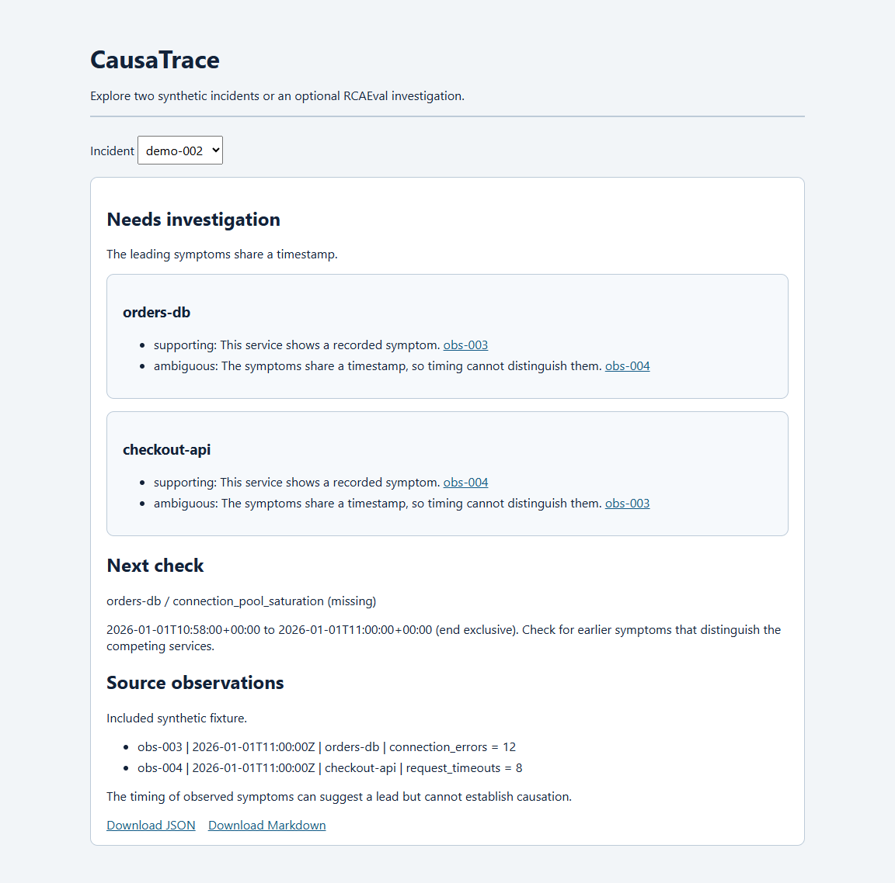

# CausaTrace

I'm building CausaTrace to help investigate failures in distributed systems. When several services start throwing errors at once, I want to see which service is the most likely starting point, what evidence points to it, and what I should check next if two explanations still fit.

Right now, the offline demo loads two synthetic incidents and prints their observations with evidence IDs. I also checked samples from RCAEval for the benchmark work. I ran the first ranking experiment on Online Boutique. The statistical baseline led on this split, and I recorded the setup and failure cases so I can compare future changes against it.

[Roadmap](docs/ROADMAP.md) · [Dataset notes](docs/DATASETS.md) · [Project design](docs/PROJECT_SPEC.md) · [First benchmark results](docs/EVALUATION.md)

## Run the offline demo on Windows

From the project folder, open PowerShell and run:

```powershell
py -3.12 -m venv .venv
.\.venv\Scripts\python.exe .\scripts\run_demo.py
.\.venv\Scripts\python.exe .\scripts\run_demo.py demo-002
.\.venv\Scripts\python.exe -m unittest discover -s tests -p test_demo.py -v
```

The demo prints observations and their evidence IDs for two included synthetic incidents. It runs offline using Python's standard library. The smoke tests verify that both incidents load and print the expected IDs.

## Open the investigation dashboard

Run this from the project folder and open http://127.0.0.1:8000 in your
browser. Press Ctrl+C in PowerShell when you are done.

```powershell
.\.venv\Scripts\python.exe -m scripts.serve_demo
```

I use demo-001 to show a leading hypothesis and demo-002 to show what
happens when the timing is tied. You can follow each citation to its
source and download either report as JSON or Markdown. The
[API notes](docs/ARCHITECTURE.md) describe what the local server exposes.

To add a held-out Online Boutique incident to the dashboard, first
[run the benchmark setup](docs/EVALUATION.md), then start it with:

```powershell
.\.venv\Scripts\python.exe -m scripts.serve_demo --benchmark
```

The benchmark view compares the learned ranking with the anomaly
baseline and links its claims to recorded metric values.

For an incident with metrics, logs, and traces, follow the
[Train Ticket walkthrough](docs/DATASETS.md#investigate-train-ticket-with-three-sources).

## Linux and macOS

From the project folder, use Python 3.12:

```sh
python3.12 -m venv .venv
.venv/bin/python -m scripts.serve_demo
```

Open [the dashboard](http://127.0.0.1:8000) and choose an incident.
For the benchmark commands, use .venv/bin/python in place of the
Windows executable.

## Run the offline dashboard in Docker

```sh
docker compose up --build
```

Open [the dashboard](http://127.0.0.1:8000). Press Ctrl+C to stop the
server, then run docker compose down to remove the container. The
image includes the two synthetic cases and serves both export formats.

## Watch an investigation

The walkthrough starts with a leading hypothesis, switches to an
ambiguous case, then opens the Train Ticket trace citation and exports
the report. [Download the walkthrough](https://github.com/Nancy2820047/causatrace/releases/download/v0.1.0/causatrace-walkthrough.webm)



[Train Ticket screenshot](docs/media/train-ticket.png)
