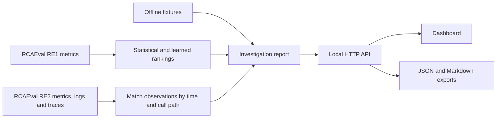

# How the offline investigation works

The browser asks the local Python server for an incident report. The dashboard shows the verdict, competing hypotheses, evidence timeline, and source observations. The server loads the fixture and runs the timing
check in scripts/evidence_gap.py. The report lists candidate services,
the records behind their claims, and a next check when timing leaves
the two leading candidates tied.

| Request | Response |
| --- | --- |
| GET / | Incident dashboard |
| GET /api/incidents | Incident IDs available in the selected startup mode |
| GET /api/incidents/demo-001 | JSON report with source observations |
| GET /api/incidents/demo-001.md | Markdown report with evidence IDs |
| GET /api/incidents/demo-002 | JSON report that asks for more evidence |
| GET /api/incidents/train-ticket | Train Ticket report with metrics, logs, and traces when started with the Train Ticket flag |

The server binds to 127.0.0.1. An unknown incident returns a JSON 404.
Every citation resolves against the observations in that incident.
A timestamp tie triggers an abstention and reports whether the proposed
signal exists in the requested time window. An earlier symptom gives
the investigator a lead. Establishing a cause would need more evidence.

I can also start the dashboard with the benchmark flag after caching
the 125 RE1-OB cases. It trains the logistic ranker on the frozen
training groups and opens the alphabetically first held-out case.
The report shows raw metric observations with a column name, row index,
timestamp and source revision. The ranker scores do not use the source
case name or fault label. The report keeps the source name for audit.

The benchmark report asks for more investigation because the case
contains metrics only. The timing-based examples and the benchmark
report have separate decision rules. The acquisition policy is
evaluated in offline replay.

Run with the Train Ticket flag to see a benchmark incident where the metric leaders tie. The report compares repeated calls before and after the alert and suggests checking two other caller paths. The duration chart uses the values in the report. [Train Ticket setup](DATASETS.md#investigate-train-ticket-with-three-sources)
